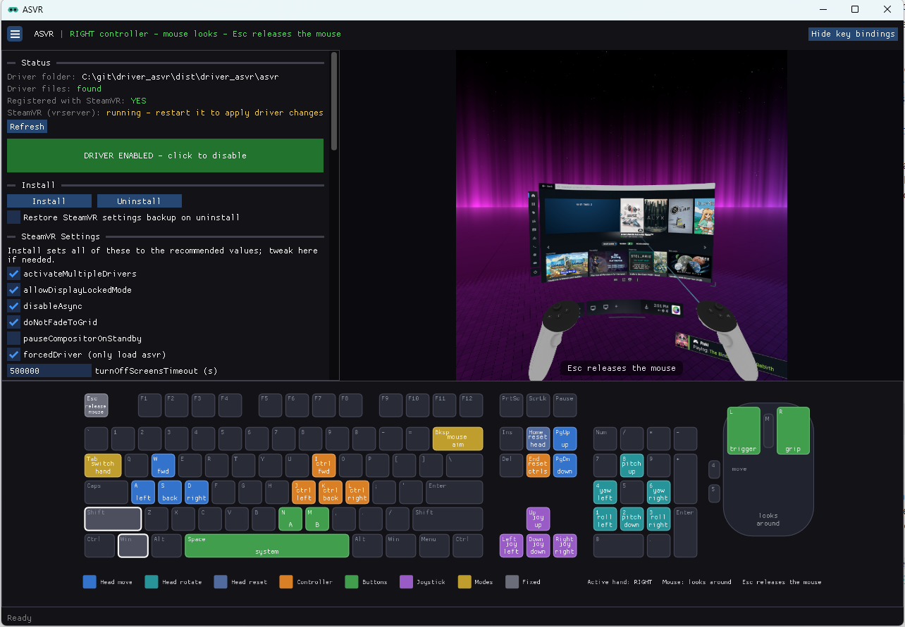

# driver_asvr [](https://opensource.org/licenses/MIT)

**Artificially Simulated Virtual Reality (ASVR)** - a virtual SteamVR headset
for testing and development, no hardware required. You
get a simulated HMD and a virtual controller for each hand, driven with mouse
and keyboard from a desktop window that shows a live view of the VR scene. It
works on fully headless machines and over Remote Desktop, on **Windows and
Linux**. On both the driver implements SteamVR's `IVRDriverDirectModeComponent`
(with D3D11 on Windows, Vulkan on Linux), so the compositor never needs a real
display or hardware vsync; the frames it composites are published in shared
memory, where the window and `asvr_ctl` read them without touching the GPU.



## Quickstart

1. Download `driver_asvr.zip` (Windows) or `driver_asvr_linux.tar.gz` (Linux)
   from the Releases page, or build it yourself with `tools/package.ps1` /
   `tools/package.sh`. Extract the `driver_asvr` folder somewhere permanent
   and user-writable - not Program Files.
2. Run `asvr_monitor.exe` (`./asvr_monitor` on Linux). The ASVR window opens
   with its **Settings** panel open on first start: click **Install**.
3. Click **Start SteamVR** on the main screen - the window offers one button
   per SteamVR install listed in `openvrpaths.vrpath` - or start SteamVR from
   Steam as usual; the driver then opens the ASVR window itself if it is not
   already open (never a second copy). Click inside the view, look around
   with the mouse, move with WASD.

That window is the whole product. Its Settings panel, opened with the
hamburger (three-line) button in the top bar, holds Install and Uninstall, the
driver enable switch, the SteamVR flags, resolution and refresh rate, the
virtual trackers, the key bindings and "Reset Saved Pose". While SteamVR is
not running the main screen says so and offers the Start buttons; when SteamVR
quits, a window the driver opened closes with it and one you opened yourself
goes back to that screen.

Install registers the driver with SteamVR and flips some `steamvr.vrsettings`
flags. Uninstall from the same panel puts everything back.

If another HMD driver claims the headset slot first (a connected Index does,
and Steam Link/vrlink does even without a headset streaming), ASVR stays out
of its way: the driver starts neither the virtual headset nor its controllers
and trackers, and it does not open the window. A window you open yourself says
which headset owns the slot and points at the **forcedDriver** checkbox in
Settings - SteamVR will then only consider ASVR until you untick it.

## Controls

The controller keys drive one *active* controller at a time - right hand by
default, Tab to switch. Everything here is rebindable in the Settings panel;
these are the defaults:

| Input | Action |
| --- | --- |
| Mouse | look around |
| `W A S D` | move the head |
| `PgUp` / `PgDn` | move up / down |
| Numpad `4/6` `8/2` `1/3` | head yaw / pitch / roll |
| `Home` | reset the head: back to the origin, looking straight ahead, no roll |
| `End` | reset both controllers to their default offsets |
| `Tab` | switch the active controller (right ⇄ left) |
| `Backspace` | toggle the mouse between head look and aiming the controller |
| Left click | trigger |
| Right click | grip |
| Arrow keys | joystick |
| `N` / `M` | A / B buttons (X / Y when the left controller is active) |
| `I J K L` | move the active controller forward / left / back / right |
| `Space` | system button (SteamVR dashboard) |
| `Esc` | release the mouse |

The bottom of the window draws the current bindings on a keyboard (plus the
mouse), colour-coded by what they do, with pressed keys lit up. That strip and
the Settings panel can each be collapsed; the window remembers both states
(and its size) across runs in `%LOCALAPPDATA%\asvr\asvr_monitor.json`
(`~/.local/state/asvr/asvr_monitor.json` on Linux).

The controllers follow your head at an offset, like wands held out in front of
you. The headset pose is saved when SteamVR shuts down and restored next
launch; `Home` resets it while SteamVR is running, and "Reset Saved Pose" in
the Settings panel clears the saved one so the next launch starts at the
origin.

## Programmatic control (asvr_ctl)

`asvr_ctl.exe` (ships next to the driver in `asvr\bin\win64`, or `asvr_ctl`
in `asvr/bin/linux64`) drives the headset programmatically. It talks to the
driver over a named pipe (a unix socket on Linux) and reads the shared frame
block directly - no GPU access needed - giving a full observe -> act loop:
screenshot, decide, move/click, screenshot again.

```
asvr_ctl status                                  poses (HMD + controller offsets)
asvr_ctl hmd_rotate 45 0                         look 45° right
asvr_ctl hmd_translate 0 0 -0.5                  step forward half a meter
asvr_ctl hmd_pose 0 0 0 0 0 0 1                  absolute pose (x y z qx qy qz qw)
asvr_ctl ctrl right aim 0 -10                    aim the laser 10° below the view centre
asvr_ctl ctrl right button trigger click         press + auto-release (~150 ms)
asvr_ctl ctrl left joystick 0 1                  held until changed
asvr_ctl screenshot view.png --wait-new-frame    save the HMD view (left eye)
asvr_ctl frame                                   frame counter / resolution
asvr_ctl -                                       batch mode: commands from stdin
```

Units are meters and degrees. Positive yaw turns right, positive pitch looks
up. `asvr_ctl --help` documents the full vocabulary. Exit codes: 0 ok, 1 the
driver rejected the command, 2 transport failure (SteamVR not running etc.).

## Virtual trackers

The driver also creates Vive-style trackers (`TrackedDeviceClass_GenericTracker`, controller type
`vive_tracker`), one per role in the `trackers` setting. They are **off by default** (`none`); turn
them on with the checkboxes under "Virtual Trackers" in the Settings panel ("Waist + Feet" is the
usual three-point set), or set the key by hand to a comma-separated list of roles: waist, chest,
left_foot, right_foot, left_knee, right_knee, left_elbow, right_elbow, left_shoulder, right_shoulder
and handheld. On first activation each one writes its SteamVR role into the `trackers` section of
`steamvr.vrsettings` (`/devices/asvr/asvr_tracker_<role>`), the same key SteamVR's own tracker-role UI
writes, so a role you reassign there sticks. SteamVR's OpenXR runtime then exposes them as `/user/vive_tracker_htcx/role/<role>`.

Trackers follow the head at an offset like the controllers (hips 0.75 m below the eye, feet 1.6 m
below and 0.12 m apart) until a command moves them:

```
asvr_ctl tracker list                                     the trackers that exist
asvr_ctl tracker waist offset 0 -0.75 0 0 0 0 1           head-relative pose
asvr_ctl tracker left_foot pose -0.12 0.05 0 0 0 0 1      absolute pose
asvr_ctl tracker right_foot tracking off                   report it as lost (and on again)
```

The window has no keys for them; `status` lists their poses.

Two SteamVR behaviours to know when driving apps this way: a tracker's role is read by SteamVR when
the device activates, and the driver writes it then, so new trackers get their roles at the *next*
SteamVR start; and SteamVR's OpenXR runtime often leaves a scene application's session VISIBLE but
never FOCUSED (no input reaches it) until something makes it re-evaluate focus - showing and hiding
the dashboard does (`vrcmd --showdashboard`, `vrcmd --hidedashboard`, or the system button twice).

## Configuration

Settings use the standard SteamVR mechanism: defaults ship in
`resources/settings/default.vrsettings`, user overrides live in the
`driver_asvr` section of `steamvr.vrsettings`. The Settings panel of the ASVR
window edits all of it, but the keys are ordinary vrsettings values if you'd
rather poke them by hand:

* `enable` - the big switch at the top of the Settings panel. SteamVR skips
  the driver entirely when this is false; no need to unregister anything.
* `resolutionWidth` / `resolutionHeight` - virtual headset resolution
  (default 1024x768)
* `fps` - virtual headset refresh rate (default 60)
* `keyMoveForward`, `keyTrigger`, ... - the window's key bindings, stored as
  Windows virtual-key codes on both platforms (the window translates them to
  GLFW keys at startup, so a config edited on either OS means the same thing
  on the other)
* `trackers` - the virtual trackers to create, by role; `none` by default
  (see Virtual trackers)
* `positionX/Y/Z`, `rotationX/Y/Z/W` - the saved pose, written by the driver
  on shutdown

The Settings panel also exposes `steamvr.forcedDriver`, off by default and not
part of Install. It makes SteamVR ignore every other HMD driver - usually
`activateMultipleDrivers` is all you need, but it's there if something keeps
stealing the HMD slot. Uninstall clears it so it can't strand SteamVR pointing
at a driver that's gone.

The window's own layout state (panel open/collapsed, size) is not a vrsettings
key; it lives in `asvr_monitor.json` as described under Controls.

## Building

Everything is vendored in-tree (`openvr`, `glm`, `imgui`, `glfw`,
`nlohmann/json`, `stb`, `volk`, Vulkan headers), pinned to the tested
versions - deliberately not submodules, a clone is all you need.

### Windows

* **Driver + asvr_ctl**: open `driver_asvr.sln` in Visual Studio 2022, or
  `msbuild driver_asvr.sln /p:Configuration=Release /p:Platform=x64`.
* **ASVR window** (CMake): `cmake -S asvr_monitor -B build/asvr_monitor -A x64`
  then `cmake --build build/asvr_monitor --config Release` ->
  `bin/win64/asvr_monitor.exe` (with `openvr_api.dll` copied next to it).
* **Release zip**: `tools/package.ps1` does all of the above and assembles
  `dist/driver_asvr.zip`.

### Linux

One CMake build covers all three targets (`driver_asvr.so`, `asvr_monitor`,
`asvr_ctl`):

    cmake -S . -B build/linux -DCMAKE_BUILD_TYPE=Release
    cmake --build build/linux -j$(nproc)

Outputs land in `bin/linux64/`. `tools/package.sh` builds and assembles
`dist/driver_asvr_linux.tar.gz`. Build on a glibc <= 2.35 distro (Ubuntu
22.04 is what CI uses) with `build-essential cmake xorg-dev libgl1-mesa-dev`;
the binaries link libstdc++/libgcc statically so they run inside Steam's
pinned runtime. On an immutable OS like SteamOS, build in a container:

    distrobox create --name asvr-build --image ubuntu:22.04
    distrobox enter asvr-build   # apt install the packages above, then cmake

For a dev loop without packaging, register the repo directly once:
create a folder with `driver.vrdrivermanifest` (a copy of
`bin/driver.vrdrivermanifest`, the same manifest both platforms ship), a
`bin/linux64` symlink to the repo's `bin/linux64` and a `resources` symlink to
`resources/`, then `.../SteamVR/bin/vrpathreg.sh adddriver <that folder>`.
Restart SteamVR after each rebuild.

### Releases

CI builds and packages both platforms on every push. Pushing a `v*` tag
(`git tag v1.2.0 && git push origin v1.2.0`) also publishes a GitHub release
with `driver_asvr.zip` and `driver_asvr_linux.tar.gz` attached. To write the
release notes yourself, draft the release for that tag first; CI then only
uploads the packages to it.

## Headless / Remote Desktop notes

* The driver is a direct-mode device: SteamVR's compositor hands it every
  submitted layer (the scene, overlays, the dashboard) and the driver
  composites them itself with D3D11, then publishes the pixels in a named
  file mapping (`Local\driver_asvr_frame_v2`) that the window and `asvr_ctl`
  simply copy out of. No GPU access on their side and no adapter matching, so
  it does not matter which display adapter an RDP session hands them.
* An RDP session counts as a *locked workstation*, and SteamVR silently refuses
  to composite app frames on a locked machine - you get a teal void with no
  error anywhere. `allowDisplayLockedMode` fixes it, and Install sets it for
  you.
* Remote desktops never deliver relative mouse motion; the pointer arrives as
  absolute positions. The window derives look deltas from consecutive
  positions, warps the cursor back to the centre only when it nears the window
  edge, and drops the jump an injected pointer makes right after such a warp.
  A pointer the warp cannot move (Chrome Remote Desktop keeps its own where
  the client left it) can simply be held against a window edge: the view keeps
  turning that way until it is moved back. In other words: mouse look works
  over RDP and Chrome Remote Desktop, no tweaking needed.
* Keep the RDP session connected while you're using the window. Windows
  tears down the remote display when you disconnect; the VR side itself keeps
  running.
* When something goes wrong, driver problems land in `Steam\logs\vrserver.txt`
  and `vrcompositor.txt`, window problems in `%TEMP%\asvr_monitor.log`.

## Linux notes

* Tested on SteamOS with SteamVR 2.16 and 2.17 on Mesa/RADV.
  SteamVR must run in a desktop session.
* The frame path is `IVRDriverDirectModeComponent` +
  `IVRIPCResourceManagerClient` (SteamVR >= 2.5 required): the driver imports
  the compositor's shared Vulkan images by fd, blits both eyes side-by-side
  and publishes the pixels in POSIX shared memory
  (`/dev/shm/driver_asvr_frame_v2`) where the window and `asvr_ctl` read
  them - consumers need no GPU access at all. Only the scene layer is
  captured on Linux (overlays and the dashboard are not; on Windows the
  driver composites every layer). If Vulkan or the resource manager is
  unavailable the driver stays up headless: tracking and input keep working,
  only frames are missing.
* The control channel is an abstract unix socket
  (`@driver_asvr_control_v1.<uid>`) - abstract because vrserver runs inside
  the Steam Linux Runtime container, whose private `/tmp` and
  `$XDG_RUNTIME_DIR` would hide a path-bound socket from the host.
* Driver problems land in `~/.local/share/Steam/logs/vrserver.txt` and
  `vrcompositor.txt`, window problems in
  `~/.local/state/asvr/asvr_monitor.log`.
* Async reprojection is disabled by Install (`enableLinuxVulkanAsync: false`);
  it is the main source of direct-mode instability on RADV.

## License

MIT - see [LICENSE](LICENSE).
