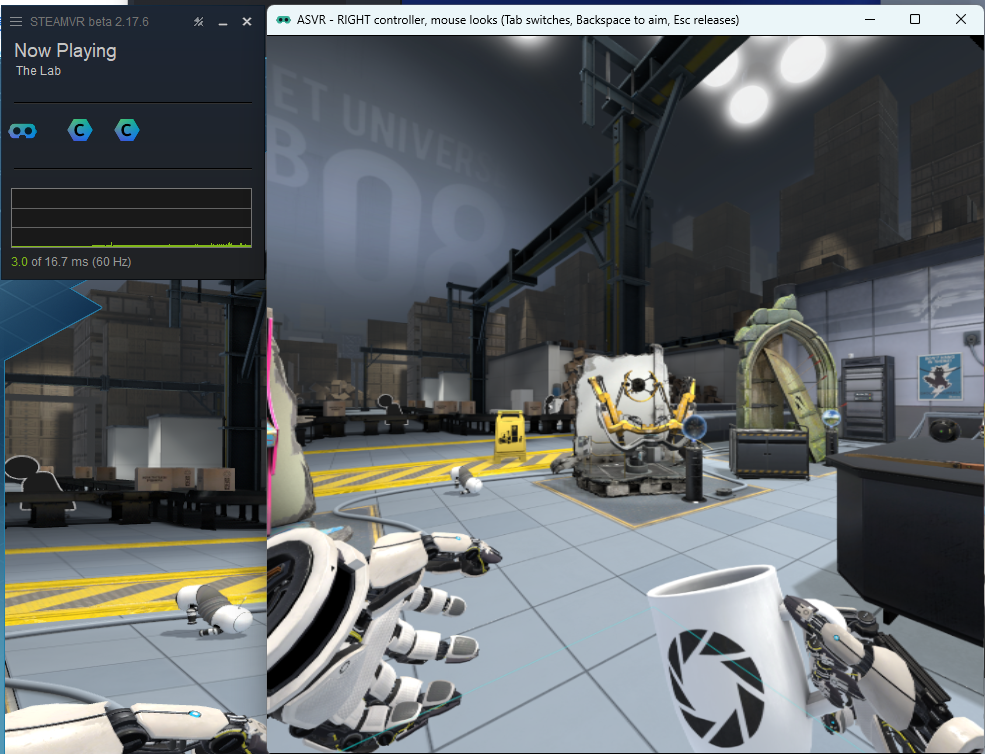

# driver_asvr [](https://opensource.org/licenses/MIT)

**Artificially Simulated Virtual Reality (ASVR)** - a virtual SteamVR headset
for testing and development, no hardware required. You
get a simulated HMD and a virtual controller for each hand, driven with mouse
and keyboard from a desktop window that shows a live view of the VR scene. It
works on fully headless machines and over Remote Desktop - the driver implements
SteamVR's `IVRVirtualDisplay` path, so the compositor never needs a real display
or hardware vsync.



## Quickstart

1. Download `driver_asvr.zip` from the Releases page, or build it yourself
   with `tools/package.ps1`. Extract the `driver_asvr` folder somewhere
   permanent and user-writable - not Program Files.
2. Run `Config.exe`, click **Install**.
3. Start SteamVR. An "ASVR" window appears; click inside it, look around
   with the mouse, move with WASD.

Install registers the driver with SteamVR and flips some `steamvr.vrsettings` 
flags. Uninstall from the same window puts everything back.

## Controls

The controller keys drive one *active* controller at a time - right hand by
default, Tab to switch. Everything here is rebindable in `Config.exe`; these are
the defaults:

| Input | Action |
| --- | --- |
| Mouse | look around |
| `W A S D` | move the head |
| `PgUp` / `PgDn` | move up / down |
| Numpad `4/6` `8/2` `1/3` | head yaw / pitch / roll |
| `Home` | reset the head: back to the origin, looking straight ahead, no roll |
| `End` | reset both controllers to their default offsets |
| `Tab` | switch the active controller (right ⇄ left) |
| `Backspace` | toggle the mouse between head look and aiming the controller |
| Left click | trigger |
| Right click | grip |
| Arrow keys | joystick |
| `N` / `M` | A / B buttons (X / Y when the left controller is active) |
| `I J K L` | move the active controller forward / left / back / right |
| `Space` | system button (SteamVR dashboard) |
| `Esc` | release the mouse |

The controllers follow your head at an offset, like wands held out in front of
you. The headset pose is saved when SteamVR shuts down and restored next
launch; `Home` resets it while SteamVR is running, and "Reset Saved Pose" in
`Config.exe` clears the saved one so the next launch starts at the origin.

## Programmatic control (asvr_ctl)

`asvr_ctl.exe` (ships next to the driver in `asvr\bin\win64`) drives the
headset programmatically. It talks to the driver over a named pipe and reads 
the shared frame texture directly, giving a full observe -> act loop: 
screenshot, decide, move/click, screenshot again.

```
asvr_ctl status                                  poses (HMD + controller offsets)
asvr_ctl hmd_rotate 45 0                         look 45° right
asvr_ctl hmd_translate 0 0 -0.5                  step forward half a meter
asvr_ctl hmd_pose 0 0 0 0 0 0 1                  absolute pose (x y z qx qy qz qw)
asvr_ctl ctrl right aim 0 -10                    aim the controller laser
asvr_ctl ctrl right button trigger click         press + auto-release (~150 ms)
asvr_ctl ctrl left joystick 0 1                  held until changed
asvr_ctl screenshot view.png --wait-new-frame    save the HMD view (left eye)
asvr_ctl frame                                   frame counter / resolution
asvr_ctl -                                       batch mode: commands from stdin
```

Units are meters and degrees. Positive yaw turns right, positive pitch looks
up. `asvr_ctl --help` documents the full vocabulary. Exit codes: 0 ok, 1 the
driver rejected the command, 2 transport failure (SteamVR not running etc.).

## Configuration

Settings use the standard SteamVR mechanism: defaults ship in
`resources/settings/default.vrsettings`, user overrides live in the
`driver_asvr` section of `steamvr.vrsettings`. `Config.exe` edits all of
it, but the keys are ordinary vrsettings values if you'd rather poke them by
hand:

* `enable` - the big switch at the top of `Config.exe`. SteamVR skips the
  driver entirely when this is false; no need to unregister anything.
* `resolutionWidth` / `resolutionHeight` - virtual display resolution
  (default 1024x768)
* `fps` - virtual display refresh rate (default 60)
* `keyMoveForward`, `keyTrigger`, ... - the monitor key bindings, stored as
  Windows virtual-key codes
* `positionX/Y/Z`, `rotationX/Y/Z/W` - the saved pose, written by the driver
  on shutdown

`Config.exe` also exposes `steamvr.forcedDriver`, off by default and not part
of Install. It makes SteamVR ignore every other HMD driver - usually
`activateMultipleDrivers` is all you need, but it's there if something keeps
stealing the HMD slot. Uninstall clears it so it can't strand SteamVR pointing
at a driver that's gone.

## Building

Everything is vendored in-tree (`openvr`, `glm`, `imgui`, `glfw`,
`nlohmann/json`), pinned to the tested versions - deliberately not submodules,
a clone is all you need.

* **Driver + monitor**: open `driver_asvr.sln` in Visual Studio 2022, or
  `msbuild driver_asvr.sln /p:Configuration=Release /p:Platform=x64`.
* **Config tool** (CMake): `cmake -S config_tool -B build/config_tool -A x64`
  then `cmake --build build/config_tool --config Release`
* **Release zip**: `tools/package.ps1` builds all of the above and assembles
  `dist/driver_asvr.zip`.

## Headless / Remote Desktop notes

* An RDP session counts as a *locked workstation*, and SteamVR silently refuses
  to composite app frames on a locked machine - you get a teal void with no
  error anywhere. `allowDisplayLockedMode` fixes it, and Install sets it for
  you.
* RDP never delivers relative mouse motion; raw input arrives as absolute
  positions instead. The monitor detects that and derives look deltas from
  consecutive positions, recentering the cursor before it can pin against the
  window edge. In other words: mouse look works over RDP, no tweaking needed.
* Keep the RDP session connected while you're using the monitor window. Windows
  tears down the remote display when you disconnect; the VR side itself keeps
  running.
* When something goes wrong, driver problems land in `Steam\logs\vrserver.txt`
  and `vrcompositor.txt`, monitor problems in `%TEMP%\asvr_monitor.log`.

## License

MIT - see [LICENSE](LICENSE).
